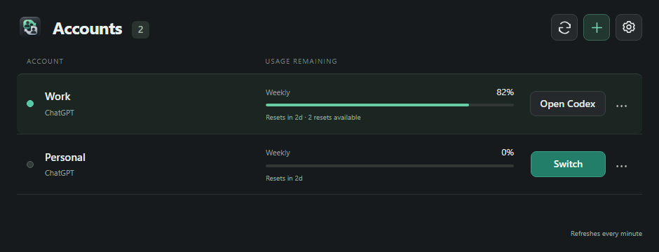

# Codex Accounts

Codex Accounts is a small Windows app for saving and switching the ChatGPT accounts used by Codex Desktop.

**1.0.0-rc.1 | Windows x64 | AGPL-3.0-only**

[](https://github.com/SUaDtL/codex-accounts/releases/download/v1.0.0-rc.1/codex-accounts-windows-x64.zip)



The app keeps account credentials in an encrypted local vault, shows the usage windows reported for each account, and uses Codex's official browser sign-in when you add or repair an account. It does not combine plans, rotate accounts automatically, or expose account access as an API.

## Download

Download [1.0.0-rc.1 for Windows](https://github.com/SUaDtL/codex-accounts/releases/download/v1.0.0-rc.1/codex-accounts-windows-x64.zip), extract the archive, and run `codex-accounts-desktop.exe`.

Windows may show an unknown publisher or SmartScreen warning because the executable does not have a commercial Windows code-signing certificate. The immutable release includes a Cosign-signed archive, checksums, a software bill of materials, and source code. See [Verify a download](docs/verify-download.md) if you want to check the artifact before running it.

Requirements:

- Windows x64
- The Microsoft Store version of Codex Desktop
- Microsoft Edge WebView2

Versioned releases are immutable and keep their corresponding source and verification material. The separate [Preview channel](https://github.com/SUaDtL/codex-accounts/releases/tag/preview) continues to follow the latest successful build from `main`.

## Use it

1. Create a vault on first use, or open the vault already on the computer.
2. Select **+** to save the current account or sign in to another account.
3. Give the account a label that makes sense to you.
4. Quit Codex clients before saving, signing in, or switching.
5. Select **Switch** beside the account you want to use.

The lit indicator marks the last known active account. Usage refreshes once per minute while the account window is visible. Codex can remain open while usage is monitored. Expired credentials remove live usage values until the account is authenticated again.

Closing the window keeps Codex Accounts in the system tray. Select the tray icon to
reopen it. The tray menu lists saved accounts for quick switching and also provides
Open and Quit.

Vaults are encrypted and protected for your Windows user. An optional strong passphrase
can be added in Settings for another layer of protection. A passphrase-protected vault
locks when you close the account window to the tray.

Accounts use the same Codex projects and conversation history on this computer. Switching changes the installed sign-in. It does not move or isolate that history.

## Supported setup

Codex Accounts checks the installed runtime, credential storage, policy, and running clients when an operation begins. Regular Codex updates do not require an app update or version allowlist.

The current preview supports native Windows file-backed ChatGPT sign-ins. It does not support WSL, API-key accounts, custom providers, macOS account switching, automatic account rotation, or concurrent use of saved accounts.

## Build from source

Install Rust 1.90.0 and Visual Studio C++ Build Tools with the Windows SDK, then run:

```console
python tools/check_dependencies.py
cargo fetch --locked
cargo build -p codex-accounts-desktop --release --locked --offline
```

The executable will be at `target/release/codex-accounts-desktop.exe`. The interface is embedded, so Node is not required to build or run the desktop app.

## Documentation

- [User guide](docs/user-guide.md)
- [Contributing](CONTRIBUTING.md)
- [Architecture](docs/architecture.md)
- [CI and releases](docs/ci.md)
- [Maintainer release guide](docs/releasing.md)
- [Changelog](CHANGELOG.md)
- [Security](SECURITY.md)
- [Security model](docs/security-model.md)
- [Documentation index](docs/README.md)

## License

Codex Accounts is licensed under [GNU AGPL version 3 only](LICENSE). Third-party dependencies retain their own licenses.
